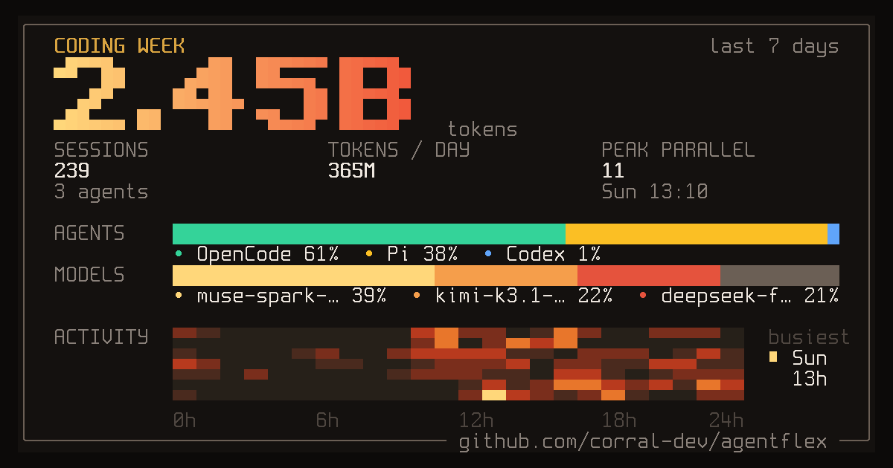

## x0c

I build local-first tools for heavy AI coding workflows and native macOS utilities — mostly things I needed myself first as a daily token burner.

#### 🚀 Flagship — AI Coding Workflow Suite
- **[corral](https://github.com/corral-dev/corral)** — run Claude Code, Codex, OpenCode, Cursor, and Pi side by side in a terminal session manager, hand off context for reviews, and continue from native **[iPhone & Mac clients](https://github.com/corral-dev/corral-apple)** · *Python / Swift / Go*
- **[subswap](https://github.com/x0c/subswap)** — check live quota and switch Claude Code, Codex, Kimi Code, Cursor, OpenCode, and Command Code accounts without signing in again · *Rust*
- **[agentsync](https://github.com/x0c/agentsync)** — one local source of truth for `AGENTS.md`, `CLAUDE.md`, skills, and MCP configs across 20+ tools · *Go*

#### 🛠️ Agent Skills & Libraries
- **[agent-doc-skills](https://github.com/x0c/agent-doc-skills)** — navigable project knowledge base skills (`doc-init`, `doc-update`, `doc-compact`) so coding agents don't rediscover your repo every session
- **[image-skills](https://github.com/x0c/image-skills)** & **[agent-friendly-cli-skill](https://github.com/x0c/agent-friendly-cli-skill)** — specialized Agent Skills for asset processing and non-interactive CLI design
- **[sesskit](https://github.com/x0c/sesskit)** — Python library and JSON CLI to parse and export local Claude Code, Codex CLI, and Cursor session transcripts · *Python*
- **[agent-session-control](https://github.com/x0c/agent-session-control)** — Python library + JSON CLI + ACP adapter to launch and track local coding-agent sessions, delegating history observation to SessKit · *Python*

#### 🍎 Native macOS Utilities (Menu Bar & Desktop)
- **[MacResourceMonitor](https://github.com/x0c/MacResourceMonitor)** — menu-bar CPU monitor: see what is eating CPU, then end it
- **[HandySwitch](https://github.com/x0c/HandySwitch)** — tiny menu-bar toggles (dark mode, prevent sleep, scroll direction)
- **[NeatWebApp](https://github.com/NeatMacApps/NeatWebApp)** — turn websites into focused macOS apps with a notch launcher, edge-tucking activity Dock, and per-site element hiding
- **[Mirror](https://github.com/x0c/Mirror)** · **[OpenInput](https://github.com/x0c/OpenInput)** · **[NeatEditor & NeatPaste](https://github.com/NeatMacApps)**

#### 📊 Coding Week
<!-- agentflex-start -->

*Week of 2026-11-10 · 239 sessions · 2.45B tokens · peak 11 parallel (11-08 13:10) — auto-updated weekly by [agentflex](https://github.com/corral-dev/agentflex).*
<!-- agentflex-end -->
*If something here saves you time or tokens, star the repos so you can find them again later.*
